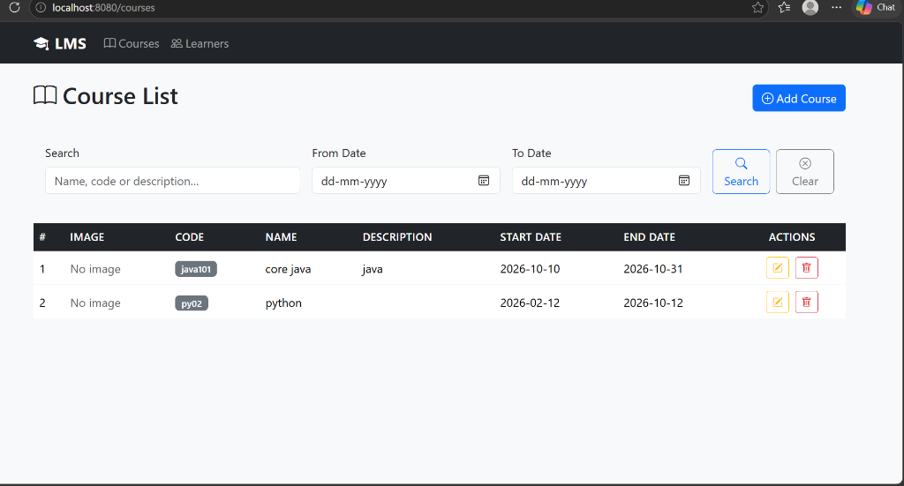
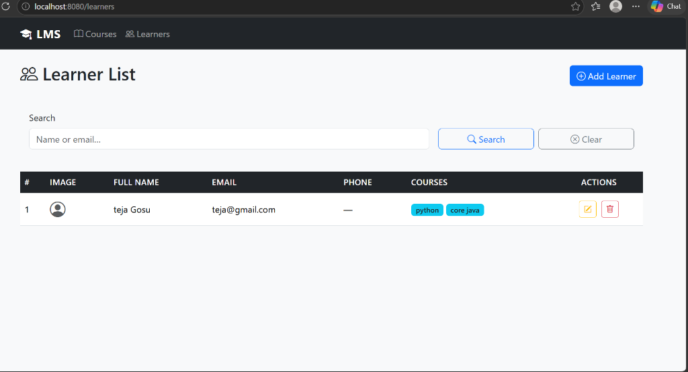

# Smart LMS System

A beginner-friendly, full-stack web application built with **Java 17**, **Spring Boot 3.5.x**, **Spring Data JPA**, **Thymeleaf**, **Bootstrap 5**, and **MySQL 8.x**.

---

## 📖 Table of Contents
1. [Overview](#-overview)
2. [Features & Web Pages](#-features--web-pages)
3. [Technology Stack](#-technology-stack)
4. [Prerequisites](#-prerequisites)
5. [Step-by-Step Setup Guide](#-step-by-step-setup-guide)
6. [Running the Application](#-running-the-application)
7. [Testing the Application](#-testing-the-application)
8. [Project Structure](#-project-structure)
9. [Database Schema](#-database-schema)
10. [Troubleshooting & Common Issues](#-troubleshooting--common-issues)

---

## 📌 Overview

The **Smart LMS System** allows administrators to manage courses and learner profiles. It features full CRUD (Create, Read, Update, Delete) operations, image uploads, search functionality, date-range filters, and multiple-course enrollment per learner.

---

## 🚀 Features & Web Pages

The application consists of 4 main responsive pages:

### Page 1 — Course List (`/courses`)
- View all courses in a styled table with thumbnail images.
- **Search bar:** Filter courses by name, code, or description.
- **Date filters:** Filter courses by start and end dates.
- Edit and delete courses with confirmation dialogues.



### Page 2 — Add / Edit Course (`/courses/add` & `/courses/edit/{id}`)
- Form fields: Unique course name, unique course code, description, start date, and end date.
- **Image upload:** Attach a course thumbnail image (stored locally in `uploads/courses/`).
- Server-side validation with instant inline error messages.

### Page 3 — Learner List (`/learners`)
- View all registered learners with profile avatars.
- View all enrolled courses displayed as badges for each learner.
- **Search bar:** Search learners by first name, last name, or email address.
- Actions: Edit learner profile or delete.



### Page 4 — Add / Edit Learner (`/learners/add` & `/learners/edit/{id}`)
- Form fields: First name, last name, unique email address, phone number.
- **Multi-course assignment:** Checkbox selection allowing learners to enroll in one or multiple courses.
- **Profile picture upload:** Upload profile avatar (stored in `uploads/learners/`).
- Validation ensures valid email formatting and at least one course selection.

---

## 🛠 Technology Stack

| Layer | Technology |
|---|---|
| **Language** | Java 17 |
| **Framework** | Spring Boot 3.5.x (Spring MVC, Spring Data JPA) |
| **Build Tool** | Maven 3.x (with included Maven Wrapper `mvnw.cmd`) |
| **Database** | MySQL 8.x |
| **ORM / JPA** | Hibernate |
| **Frontend** | Thymeleaf, HTML5, Bootstrap 5, Bootstrap Icons |
| **Validation** | Jakarta Bean Validation |

---

## 📋 Prerequisites

Before running the project, make sure you have:

1. **JDK 17 or higher** installed  
   Verify in terminal:
   ```bash
   java -version
   ```
2. **MySQL Server 8.x** running  
3. **Git** (optional, for cloning)

---

## ⚙️ Step-by-Step Setup Guide

### Step 1: Clone or Download the Repository

```bash
git clone https://github.com/maniyadav7675-cyber/Smart-LMS-System.git
cd Smart-LMS-System
```

### Step 2: Create the MySQL Database

Open MySQL Workbench, MySQL Command Line Client, or your favorite database tool, and run:

```sql
CREATE DATABASE learner_course_db CHARACTER SET utf8mb4 COLLATE utf8mb4_unicode_ci;
```

> **Note:** Spring Data JPA will automatically create all tables (`courses`, `learners`, and `learner_courses`) when the application starts. You do not need to create tables manually!

### Step 3: Configure Database Credentials

Open `src/main/resources/application.properties` and verify/update your MySQL credentials:

```properties
spring.datasource.url=jdbc:mysql://localhost:3306/learner_course_db?useSSL=false&serverTimezone=UTC&allowPublicKeyRetrieval=true
spring.datasource.username=root
spring.datasource.password=YOUR_MYSQL_PASSWORD
```

Replace `YOUR_MYSQL_PASSWORD` with your actual local MySQL root password.

---

## 🏃 Running the Application

### Option A: Using Maven Wrapper (No Maven installation required!)

On **Windows**:
```cmd
mvnw.cmd spring-boot:run
```

On **macOS / Linux**:
```bash
./mvnw spring-boot:run
```

### Option B: Using installed Maven
```bash
mvn spring-boot:run
```

### Option C: Using IntelliJ IDEA / Eclipse
1. Open the project folder in your IDE as a Maven project.
2. Locate `src/main/java/com/example/lcms/LearnerCourseManagementApplication.java`.
3. Right-click and choose **Run 'LearnerCourseManagementApplication'**.

Once started, open your web browser and navigate to:
👉 **[http://localhost:8080](http://localhost:8080)**

*(You will automatically be redirected to the Course List page)*

---

## 🧪 Testing the Application

1. **Add First Course:** Click **Add Course** → Enter Code `JAVA101`, Name `Core Java`, start/end dates, upload an image, and click **Save Course**.
2. **Add Second Course:** Add another course, e.g. `SQL101` — `Database Fundamentals`.
3. **Enroll Learner:** Go to **Learners** → **Add Learner**. Enter name, email, and select both courses via the checkboxes. Upload a profile image and save.
4. **Verify List:** Confirm that both course badges appear next to the learner on the Learner List page.
5. **Test Search & Filters:**
   - Type keyword in Course List search bar.
   - Use From/To dates to filter courses.
   - Test learner search by name or email.

---

## 📂 Project Structure

```
learner-course-management/
│
├── .mvn/wrapper/                            # Maven wrapper files
├── mvnw.cmd                                 # Windows wrapper command
├── pom.xml                                  # Project Maven dependencies
├── README.md                                # Setup documentation
│
└── src/
    ├── main/
    │   ├── java/com/example/lcms/
    │   │   ├── LearnerCourseManagementApplication.java  # Main Application class
    │   │   │
    │   │   ├── config/
    │   │   │   └── WebConfig.java                       # Static resource handler for uploads
    │   │   │
    │   │   ├── controller/
    │   │   │   ├── HomeController.java                  # Redirects / to /courses
    │   │   │   ├── CourseController.java                # Course list, add, edit, delete
    │   │   │   └── LearnerController.java               # Learner list, add, edit, delete
    │   │   │
    │   │   ├── entity/
    │   │   │   ├── Course.java                          # Course JPA Entity
    │   │   │   └── Learner.java                         # Learner JPA Entity (ManyToMany)
    │   │   │
    │   │   ├── repository/
    │   │   │   ├── CourseRepository.java                # Course search & date queries
    │   │   │   └── LearnerRepository.java               # Learner search & fetch queries
    │   │   │
    │   │   └── service/
    │   │       ├── CourseService.java                   # Course business logic
    │   │       ├── LearnerService.java                  # Learner business logic
    │   │       └── ImageStorageService.java             # File upload & storage handling
    │   │
    │   └── resources/
    │       ├── application.properties               # DB config & upload settings
    │       ├── static/css/
    │       │   └── style.css                        # Custom styling
    │       └── templates/
    │           ├── fragments/
    │           │   └── layout.html                  # Shared navbar and flash messages
    │           ├── course/
    │           │   ├── list.html                    # Page 1: Course List
    │           │   └── form.html                    # Page 2: Add/Edit Course Form
    │           └── learner/
    │               ├── list.html                    # Page 3: Learner List
    │               └── form.html                    # Page 4: Add/Edit Learner Form
```

---

## 🗄 Database Schema

The application models a **Many-to-Many** relationship between learners and courses:

- **`courses`**: `id`, `name` (unique), `code` (unique), `description`, `start_date`, `end_date`, `image_path`, `created_at`, `updated_at`
- **`learners`**: `id`, `first_name`, `last_name`, `email` (unique), `phone`, `image_path`, `created_at`, `updated_at`
- **`learner_courses`**: Join table mapping `learner_id` to `course_id`.

---

## ❓ Troubleshooting & Common Issues

- **Access denied for user 'root'@'localhost':**  
  Double check the password in `src/main/resources/application.properties`. Ensure MySQL service is running.
- **Port 8080 already in use:**  
  Change the port in `application.properties` by setting `server.port=8081`, then visit `http://localhost:8081`.
- **Uploaded images not displaying:**  
  Images are saved to an `uploads/` directory at the project root. Make sure the application has permission to write files there.